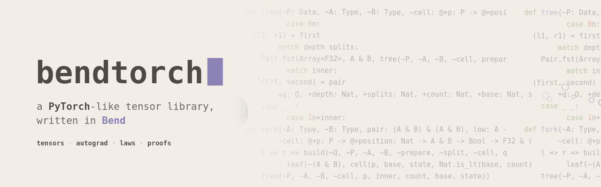
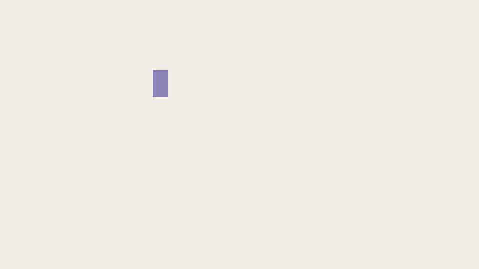
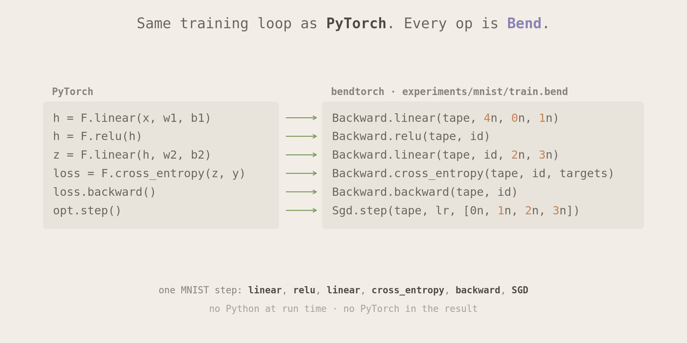
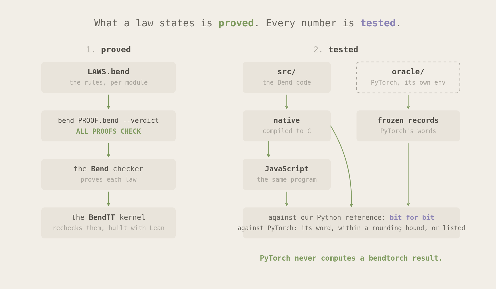
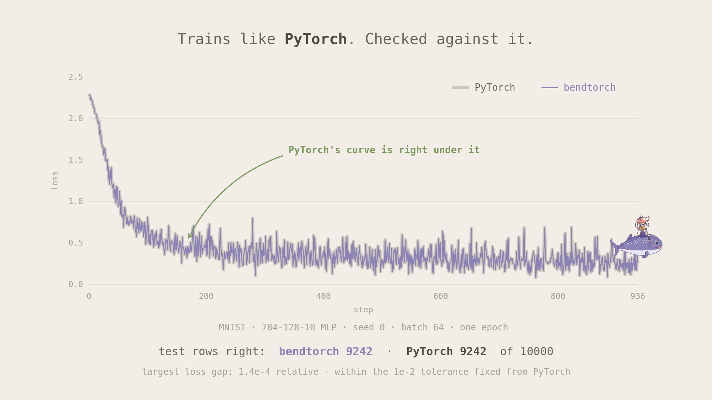
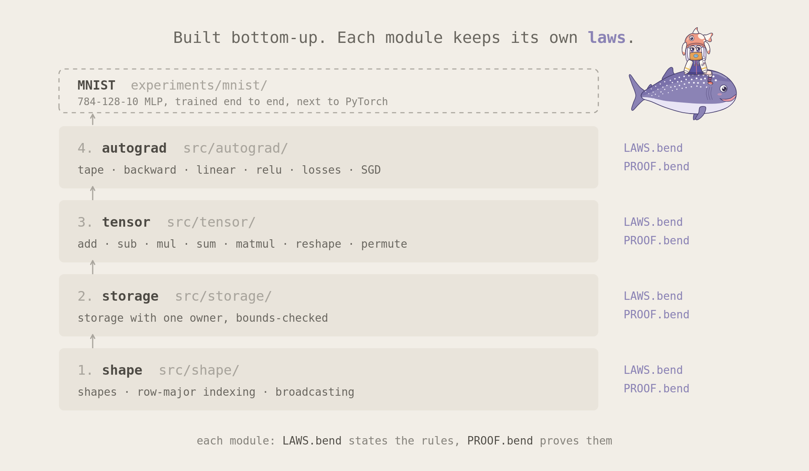
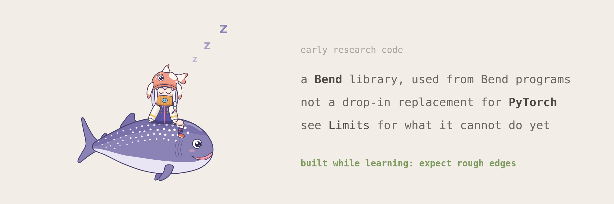

<p align="center">
  
</p>

bendtorch is a PyTorch-like tensor library written in
[Bend2](https://github.com/bendlang/bend). Its tensors, its autograd and its
optimizer are Bend code. The rules that code must keep are laws in
`LAWS.bend` files. The Bend checker proves each law, and the BendTT kernel, a
separate checker built with Lean, checks the proofs again. Python gates in
`tools/` run the same code natively and as JavaScript, and compare every
result with references, including frozen records from a separate PyTorch
project in `oracle/`. PyTorch never computes a bendtorch result.

> **Disclaimer.** bendtorch is an experiment, and im learning while building this... so expects things to be rough, broken and stupid....

<p align="center">
  
</p>

## It reads like PyTorch

<p align="center">
  
</p>

`examples/mnist/train.bend` trains a small MLP with the same steps as its
PyTorch copy in `oracle/mnist/train.py`: `linear`, `relu`, `linear`,
`cross_entropy`, `backward`, and an SGD step. The calls look alike, but
bendtorch is a Bend library, used from Bend programs. It has no Python API
and is not a drop-in replacement for PyTorch.

Every operation either consumes its inputs or gives them back to the caller.
No two tensors share mutable storage.

## Autograd records a tape and walks it back

<p align="center">
  
</p>

Each operation of a forward pass adds an entry to a tape.
`Backward.backward` seeds ones at the output you select and walks the tape in
reverse. Each entry sends its contributions to the gradient slots of its
inputs. A slot reads `None` until a contribution reaches it, as PyTorch's
`.grad` does. A constant, which is a leaf that takes no gradient, never gets
one. A broadcast contribution sums back to the shape of its operand with
`sum_to_size`. Two laws state the chain rule for every tape. `Sgd.step` then
moves each parameter to `p - lr * g`.

The laws in `src/autograd/` state what each recorded operation sends back,
and the [differences from PyTorch](docs/torch-differences.md#tensor-backward)
page describes where the results differ from PyTorch's. For `mse_loss` and
`cross_entropy`, the laws state every cell of the gradient sent back, but no
law states the loss value the tape records, the row maximum or the one-hot
rows; the runtime lanes check those against the Python reference. `F32.exp`
and `F32.log` are opaque to the checker, so a law says which of them runs, not
how close it is to the exact value.

## Large outputs build in parallel halves

<p align="center">
  
</p>

Bend runs `a b = low(l1, r1) high(l2, r2)` as two parallel calls.
`src/tensor/parallel.bend` uses that line to split the cells of a large
output, such as a `matmul` product, an elementwise result, or a `reduce_to`
gradient, into balanced halves. Every cell gets the word that the one-thread build computes there, so
no output word depends on the number of threads.

## Laws state the rules, and Bend proves them

<p align="center">
  
</p>

Each module keeps its rules in `src/<module>/LAWS.bend` and their proofs in
`src/<module>/PROOF.bend`. `bend PROOF.bend --verdict` checks every law with
the Bend checker, then rechecks the proofs with the BendTT kernel. The
general laws quantify over every input that meets their hypotheses, not over
a list of examples. A few more, such as the `relu` and SGD learning-rate edge
words, check fixed lists of edge cases.

### A one-word mistake fails the proof

<p align="center">
  
</p>

Change `F32.sub` to `F32.add` in the SGD cell of
`src/tensor/elementwise.bend`, and each step climbs the loss instead of
descending it. `bend PROOF.bend --verdict` then exits with code 1 at the law
`sgd_descend_scalar`. The terminal in the picture shows that run. The gates
make changes like this one on purpose and check that the proofs fail for the
expected reason.

## What is proved and what is tested

<p align="center">
  
</p>

The laws state what each public operation returns: the output shape, the
input element behind each output element, the order of each sum, the error
code of many failures, and that a returned input is unchanged. They treat F32
arithmetic as opaque. A law can say "this element is `F32.add` of these two
words in this order", but not that the result is correctly rounded. The
trusted base also includes the Bend compiler, the native runtime, Clang, the
BendTT translation, Lean, and the hardware. The
[proof boundary](dev/proof-boundary/BOUNDARY.md) page says which
proofs later code can use as inputs.

The numbers are tested at three levels, which the
[numeric policy](AGENTS.md#numeric-policy) defines:

1. Every gate lane, native and JavaScript, must match its Python reference
   bit for bit.
2. Against PyTorch, an operation that rounds once per output word must give
   PyTorch's word. A sum, a matmul, and every word built on one must lie
   within a published rounding-error bound. A word built on `exp` or `log`
   is listed with both values.
3. A training run must stay within a tolerance of its PyTorch copy, fixed
   from PyTorch against itself before any Bend result is compared.

The [oracle](oracle/README.md), [tensor oracle](oracle/tensor/README.md) and
[autograd oracle](oracle/autograd/README.md) pages describe the PyTorch
records and how to regenerate them. The frozen tensor corpus was used during
development, so it is regression evidence, not held-out evidence.

## It trains MNIST next to PyTorch

<p align="center">
  
</p>

The experiment trains a 784-128-10 MLP for one epoch, from the same initial
words and the same batches as PyTorch, with a new tape for every mini-batch.
`oracle/mnist/compare.py` checks each step's loss against PyTorch's: within
`1e-4` relative for the first 100 steps and `1e-2` after. It also checks that
the test count lies within `ceil(sqrt(p (1 - p) n))` rows of PyTorch's, where
`p` is PyTorch's accuracy on the `n` test rows. The figure is seed 0, with
PyTorch on its AVX512 kernels: the two runs agree on the loss word in 165 of
937 steps, differ by at most 1.4e-4 relative, and each classify 9242 test
rows right. [MNIST](docs/mnist.md) has every
seed, both PyTorch kernels, and the timings.

## How the code is laid out

<p align="center">
  
</p>

Each module builds on the one below it.

| Path | What it holds | See |
| --- | --- | --- |
| `src/shape/` | Validated shapes, row-major flatten and unflatten, checked coordinates, broadcast plans | `src/shape/LAWS.bend` |
| `src/storage/` | F32 storage with one owner and a bounds check before every access | `src/storage/LAWS.bend` |
| `src/tensor/` | The tensor core, elementwise operations, `sum`, `matmul`, `torch.matmul` (`Batched.matmul`), basic slicing (`Slice.slice`, `narrow`, `select`), `index_select` and `gather` (`Gather`), `reshape`, `permute_copy`, `transpose_copy`, PyTorch's signed axes and indices, and the proved contracts | `src/tensor/LAWS.bend` |
| `src/autograd/` | `broadcast_to`, `reduce_to`, `sum_to_size`, `sum_dims`, gradient slots, scalar and tensor `backward`, the losses, SGD | `src/autograd/LAWS.bend` |
| `bendtorch.bend` | The package entry: it imports the public modules and `PROOF.bend`, so a publish ships both | [versions and releases](docs/VERSIONING.md) |
| `examples/` | Programs that use the library: the MNIST training run | [MNIST](docs/mnist.md) |
| `dev/` | Work outside the package: the autograd prototypes, the benchmarks, the proof-boundary experiment | [autograd design](dev/autograd-prototypes/DESIGN.md) |
| `oracle/` | The PyTorch references, in their own uv project | [oracle](oracle/README.md) |
| `tools/` | One gate per suite, run by `python -m tools.check` | [AGENTS.md](AGENTS.md#gates) |

## Use it from Bend

bendtorch is a Bend package, `bendtorch@A.B.C.D` on BendHub once a version is
published; [CHANGELOG](CHANGELOG.md) lists the versions. A program imports
the modules it uses:

```python
import Base
import bendtorch@0.1.0.0/src/tensor/core.bend as Core
import bendtorch@0.1.0.0/src/autograd/tensor-backward.bend as Backward
import bendtorch@0.1.0.0/src/autograd/sgd.bend as Sgd
```

The package ships `src/` with every law and proof, and nothing else.
[Versions and releases](docs/VERSIONING.md) says what each number means and
how a release is made.

## Run it

bendtorch runs on Ubuntu 24.04 on x86_64. It needs [Bun](https://bun.sh/)
1.3.14, which runs Bend2, and [uv](https://docs.astral.sh/uv/) 0.10.2.
Bootstrap checks both versions. Native builds link with the system linker and
C library, so a minimal image, such as the `ubuntu:24.04` container, also
needs these packages:

```sh
sudo apt-get install git ca-certificates zstd binutils libc6-dev libgcc-13-dev libedit2 libxml2
```

Bootstrap fetches the one Bend2 commit pinned in
`verification/references.json`, builds the BendTT kernel, and downloads
checksum-pinned Lean 4.34.0 and Clang 19.1.1 into `.tools/`. It changes
nothing outside the repository. A `bend` already on your `PATH` can be a
different version, and it can reject this code.
[Bumping the Bend pin](docs/bend-pin.md) describes how the pin follows
upstream main. Bootstrap, then run the pinned Bend2:

```sh
uv sync --locked
uv run --locked python -m tools.bootstrap
export BEND_NO_TELEMETRY=1 BENDTT="$PWD/.tools/kernel/bendtt" LEAN_STACK_SIZE_KB=4194304
alias bend="bun $PWD/.tools/bend/bend2/main.ts"
bend guide
```

### Multiply two matrices

This program builds two matrices, multiplies them, adds a bias, and sums the
result:

```sh
export CC="$PWD/.tools/llvm/usr/bin/clang-19"
export LD_LIBRARY_PATH="$PWD/.tools/llvm/usr/lib/x86_64-linux-gnu"
mkdir -p .evidence/demo
bend src/tensor/matmul-demo.bend -o .evidence/demo/matmul-demo
.evidence/demo/matmul-demo --threads 1 --gpu off
```

It prints F32 bit patterns as decimal integers. The first five,
`1137672192`, `1114374144`, `1115422720`, `1124859904` and `1125711872`, are
the sum 415 and the matrix `[[59, 63], [140, 153]]`.

### Check the code

The `Makefile` names each group below: `make check`, `make proofs`,
`make test`, `make gates`, and `make verify` for all four. These finish in
seconds:

```sh
uv run --locked python -m unittest discover -s tests -p test_tensor_numerics.py -v
uv run --locked ruff check tools tests verification dev
uv run --locked ruff format --check tools tests verification dev
uv run --locked ty check
```

The full verification is slower and uses several GB of memory. Each gate
writes its evidence to a new directory and refuses to overwrite one, so pick
a fresh name for each run:

```sh
bend PROOF.bend --verdict
uv run --locked python -m tools.test
uv run --locked python -m tools.check all --output .evidence/check-run-1
uv run --locked python -m verification.contracts.run --output .evidence/contracts-run-1
uv run --locked python -m verification.families.run --output .evidence/families-run-1
```

`PROOF.bend` checks the laws of every module. `tools.check all` runs one gate
per suite: `toolchain` checks the pinned Bend2 and BendTT, `shape` and
`storage` check their modules, `tensor` checks the tensor laws and the frozen
PyTorch corpus, and `autograd` checks the autograd laws and the backward
pass. Name suites to run only those, as in `tools.check tensor autograd`. The
last two commands check the proved contracts and their negative controls. The
oracle has its own uv project with a CPU-only PyTorch, so PyTorch never enters
the root environment.

## Limits

<p align="center">
  
</p>

- F32 only, with no dtype promotion. At most rank 4 and 2^20 elements per
  tensor.
- No views. `reshape` moves the storage to the new shape, and `permute_copy`
  and `transpose_copy` always copy. There are no strides, no in-place methods,
  and no `out=` variants.
- Axes and indices count from either end, as in PyTorch, through
  `src/tensor/signed.bend`: `Signed.Last{0}` is `-1`. `reshape` takes one
  `-1`, `Signed.Inferred{}`. Basic slicing (`Signed.slice`, `narrow` and
  `select`, one axis at a time) copies and takes negative starts, stops and
  indices as PyTorch does. `Gather.index_select` and `gather` copy too, with
  an index of U32 entries rather than an integer tensor; there is no other
  advanced indexing (integer-tensor `a[idx]`, boolean masks).
- `sum` reduces the whole tensor. On the tape, `sum_dims` sums the listed
  axes, with or without `keepdim`. `matmul` takes two rank-2 tensors.
  `Batched.matmul`, PyTorch's `torch.matmul`, promotes 1-D inputs and
  batches, with at most two batch dimensions, and refuses an output, or a
  gradient over the output's batch, past 2^20 elements.
- `sum`, `sum_dims`, `matmul`, `reduce_to` and a reducing `sum_to_size` add
  in a fixed order. PyTorch adds in another order, so on longer inputs the
  two agree within the rounding bound, not word for word.
- Tensor `backward` records only `add`, `sub`, `mul`, `matmul`, `matmul_nt`,
  `batched_matmul` (`torch.matmul`), `sum`, `sum_dims`, `slice`, `narrow`,
  `select`, `index_select`, `gather`, `relu`, `mse_loss` and
  `cross_entropy`.
- CPU only.

The [differences from PyTorch](docs/torch-differences.md) page lists each
request that PyTorch accepts and bendtorch rejects.

## Contributing

[AGENTS.md](AGENTS.md) has the working rules: use the pinned Bend2, add a law
for each rule a later change must not break, never weaken an existing law, and
run the checks above before a pull request. There is no CI. Each pull request
lists the commands it ran, their exit codes, and the Bend commit.

## License

bendtorch is released under the [MIT License](LICENSE).
